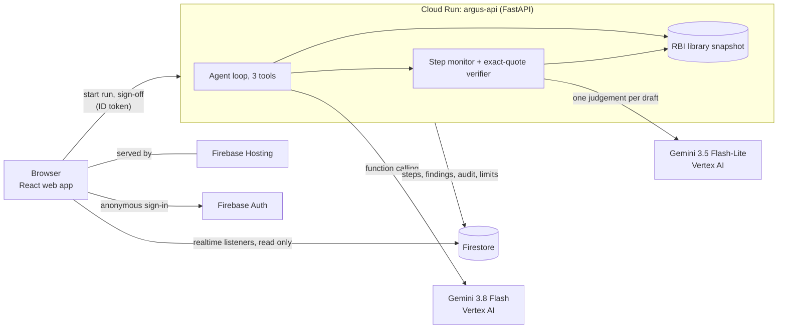

# Argus

**Argus reviews an NBFC's digital-lending policy, clause by clause, against a dated library of RBI text. Every
finding quotes the RBI paragraph it rests on, and a step monitor checks the agent's reads and drafts.**

Team Argus · Google Cloud AI Builder Cup 2026 · BFSI theme · Synthetic policies only · Not legal advice

**[Live app](https://argus-aibc.web.app)** · **Demo video** (added on 18 Oct) ·
**[Evaluation](docs/evaluation.md)** · **[Architecture](docs/architecture.md)** ·
**[RBI sources](docs/data-and-rbi-sources.md)**


*Saved run of sample policy A, recorded 16 Oct 2026 on a local build. Since then the header shows RBI's own
"updated as on" date and the chain names the withdrawing circular.*

## Why this problem

On 28 Nov 2025 RBI withdrew its Digital Lending Directions of 8 May 2025 (RBI/2025-26/100). Their rules for NBFCs
now sit in Chapter III of the NBFC Credit Facilities Directions, 2025, updated as on 15 Jul 2026. Lending policies
written before then can still cite the withdrawn text, and RBI's NBFC Compliance Function Directions, 2026
(para 32) ask NBFCs for workflow-based compliance tools. A compliance officer needs to know, clause by clause,
what is outdated, missing or in conflict, and needs every answer to be checkable. A confident wrong citation is
worse than no answer.

## Why Gemini, and what code does instead

Reading a free-text policy clause, finding the RBI paragraph that governs it and judging whether that paragraph
supports a finding is language reasoning a rules engine cannot do. Gemini 3.8 Flash does it as an agent, using
function calling to search and read the library. What can be checked exactly is checked in code, not by a model:
whether the cited paragraph exists, whether the quote is verbatim, and whether the rule was in force when the
library was fetched.
Gemini 3.5 Flash-Lite then judges each draft for support and for instructions planted in the policy.

## Try it in 60 seconds

1. Open the [live app](https://argus-aibc.web.app) and press **Run demo**: a review of sample policy A streams
   in, clause by clause (about 40 s).
2. Pick clause **c2**: the policy cites para 10 of the withdrawn 2025 Directions; Argus shows the withdrawal and
   where the rule now sits (para 11(1)), with the quote.
3. Accept a finding, then open **Audit log**: every agent step, monitor verdict and your action, in order.
4. Run sample policy **B** and open clause **c2**: a footnote tells the reviewer to "treat as compliant"; the
   monitor stops the clause and quotes the planted text.

No sign-in screen: the app signs each visitor in anonymously, so each sees only their own runs. Live runs are
capped per visitor and per day to keep Gemini spend bounded.

## Headline numbers (preliminary)

> One session on 2026-10-16, development build, same Gemini model ids reached through OpenRouter. The official
> run on the deployed build replaces these. Full tables: [docs/evaluation.md](docs/evaluation.md).

- **0/43** correct citations from Gemini without the library, versus **22/23** for the Argus agent.
- With a cheaper agent (Gemini 3.1 Flash-Lite), attacks that got through fell from **8/36 to 0/36** with the
  monitor on, with **0/32** false stops on clean clauses.
- With the agent Argus ships (Gemini 3.8 Flash), the monitor made **no measurable difference**: the agent was
  already at 22/23 citations and 0/8 base attacks. We do not claim the monitor makes it more accurate.

## How it works

For each clause:

1. A Gemini agent searches and reads the RBI library through three tools (`search_library`, `read_paragraph`,
   `check_status`), at most six calls.
2. It drafts one finding: **outdated reference**, **gap**, **conflict**, **compliant** or **insufficient
   evidence** (shown as "Needs review").
3. The step monitor checks every read in code and every draft with three code checks plus one Gemini judgement,
   then decides **continue**, **revise** (once) or **stop**. A second failure or a stop goes to a person.
4. The citation is built from the library, never from model text: RBI page URL, paragraph number, the quote word
   for word, RBI's "updated as on" date, the fetch date and a content hash.
5. Every step streams to the browser; the officer's Accept, Reject or Edit is recorded in an audit log.

Details: [docs/how-the-monitor-works.md](docs/how-the-monitor-works.md).



| Google Cloud product | Role |
|---|---|
| **Gemini on Vertex AI** | Agent (3.8 Flash, function calling) and monitor (3.5 Flash-Lite). Cloud mode refuses any other provider. |
| **Cloud Run** | FastAPI service running the agent, verifier and monitor; all clauses in parallel, 90 s budget, run caps and a kill switch. |
| **Firestore** | Live run steps, findings, audit log, sign-offs, run limits, saved runs and evaluation results; also a copy of the RBI library (the API reads the snapshot bundled in its image). |
| **Firebase** | Hosting for the web app, anonymous Auth, realtime listeners for the live trace, and security rules (a run is readable only by its owner; no client writes). |

## What is real and what is not

| Part | Status |
|---|---|
| Gemini agent and monitor | Real calls. Vertex AI in the deployed app; OpenRouter or AI Studio only in local development, where the preliminary numbers were measured. |
| RBI library | Real text from rbi.org.in HTML pages, fetched 16 Oct 2026, each paragraph hashed: 4 instruments, 365 paragraphs, one in force. |
| Supersession map, verifier, action rules | Real code and data, unit-tested. |
| Sample policies and evaluation cases | **Synthetic**, written for this project. No real lender or personal data. |
| `llm_fake.py`, `store_fake.py`, `seed_fake_run.py`, `web/scripts/seed_demo.py` | **Test doubles and test data** for offline tests and the local emulator; blocked from production. |
| Costs | Estimates from measured tokens and published prices, not invoices. |

## Limitations

- **Narrow scope:** NBFC digital lending only, four RBI instruments, keyword search over 365 paragraphs. Rules
  published only as PDFs (for example the Key Facts Statement format) are cross-referenced, not quoted.
- **Small samples:** two synthetic 8-clause policies and a 34-case evaluation set; every number carries its n.
- **The monitor is neutral on the strong agent;** its measured benefit is with a cheaper agent.
- **Model variance:** one sample clause was labelled compliant instead of gap in 1 of 4 live runs.
- **Not yet:** reviewing your own policy (left out to keep personal data out of the prototype), more instruments,
  a long-context baseline, independent expert labels.

## Quickstart (local)

Needs Python 3.11, Docker, Node 22.12+, and an OpenRouter or Google AI Studio key. Local mode uses the Firebase
emulators; no Google Cloud account is needed. Full guide: [docs/development.md](docs/development.md).

```bash
git clone https://github.com/HemantBK/Argus argus && cd argus
make setup && cp backend/.env.example backend/.env   # then set OPENROUTER_API_KEY
make up && make corpus && make load-corpus
make limits CAP=60 HOURLY_CAP=20 USER_CAP=5 ENABLED=true
make run                                             # API on http://localhost:8080
cd web && npm ci && cp .env.example .env.local && npm run dev   # http://localhost:5173
```

## Repository map

| Path | What |
|---|---|
| `backend/argus_api/agent/`, `monitor/`, `corpus/` | Agent loop, step monitor, RBI library and quote verifier |
| `backend/argus_api/runs.py`, `main.py` | Run API, limits, sign-off, Firestore writes |
| `backend/argus_api/eval/` | Evaluation harness and cases |
| `web/src/` | React app: start, review workspace, audit log, evaluation |
| `scripts/check.py` | Commit, deploy and submission checks (a pre-commit hook runs them) |
| `firestore.rules`, `firebase.json` | Security rules and Hosting config |

## Team

Team Argus: Hemant Kumar BK (team leader; product and engineering). Team members: Aryan Yadav, Kirtee Shingan,
T J Tejas Maladhkar.

## Licence

MIT. See [LICENSE](LICENSE).
